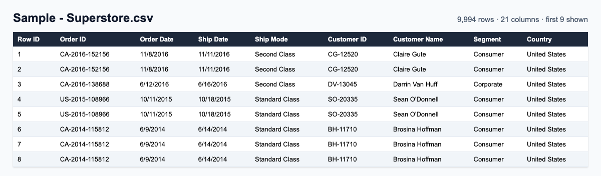
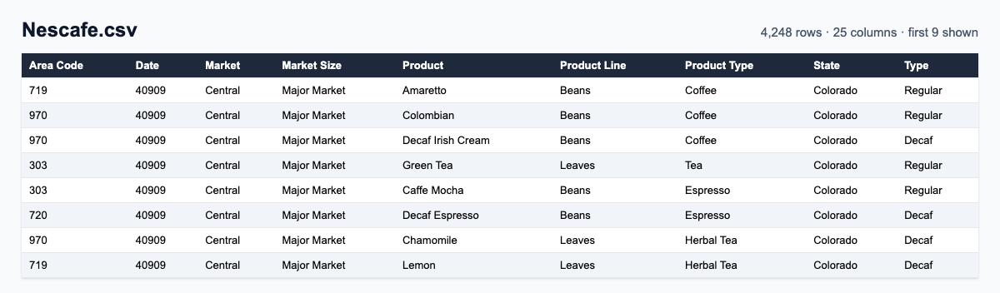
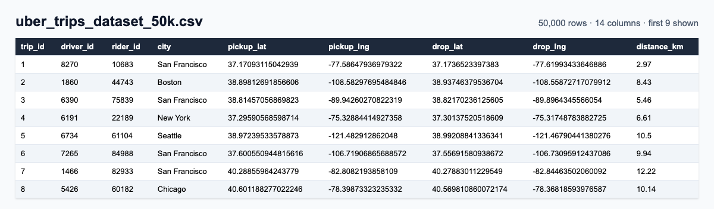
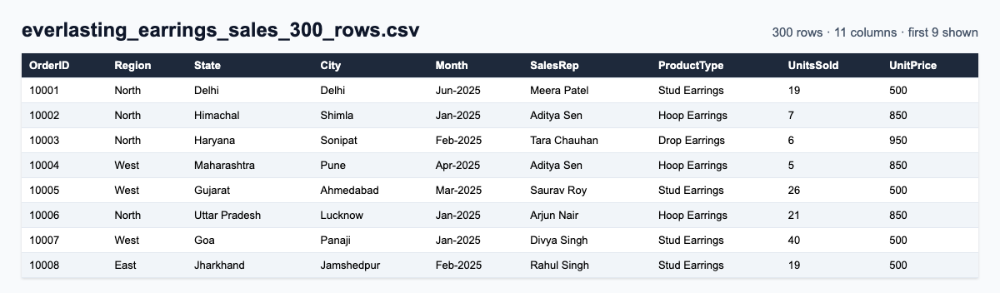
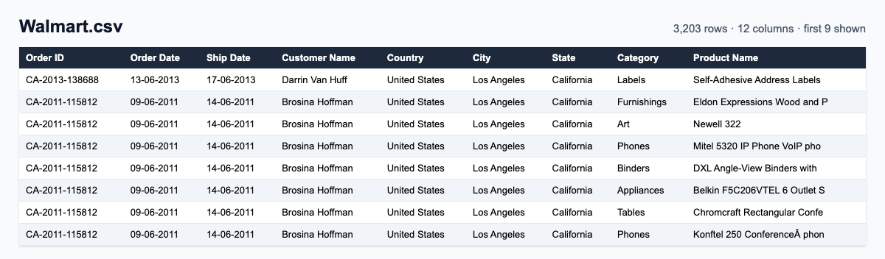
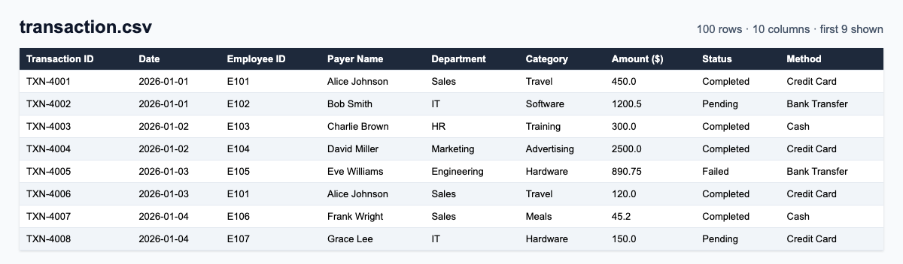
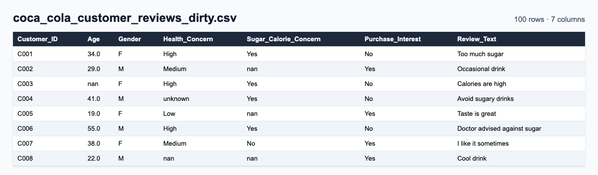

# Dataset — Practice Data for Data Analytics

Real-world-shaped CSV datasets plus step-by-step practice tasks for learning **Excel, Google Sheets, SQL and Python (pandas)**. Every file is free to download and use in class, in assignments, or for your own portfolio projects.

> If these datasets helped you, please ⭐ **star the repo** so other learners can find it.

## Datasets at a glance

| Dataset | Rows | Columns | Good for | Practice task |
|---|---:|---:|---|---|
| [Sample - Superstore.csv](Sample%20-%20Superstore.csv) | 9,994 | 21 | Sales & profit analysis, pivots, dashboards | — |
| [Nescafe.csv](Nescafe.csv) | 4,248 | 25 | Data cleaning, text & date functions, budget vs actual | [Task 01](Task_01_Nescafe.md) |
| [uber_trips_dataset_50k.csv](uber_trips_dataset_50k.csv) | 50,000 | 14 | Large-sheet analytics, time & distance analysis | [Task 02](Task_02_Uber.md) |
| [everlasting_earrings_sales_300_rows.csv](everlasting_earrings_sales_300_rows.csv) | 300 | 11 | Pivot tables, regional sales reports | [Task 03](Task_03_Pivot_Table.md) |
| [Walmart.csv](Walmart.csv) | 3,203 | 12 | Order & shipping analysis, category performance | — |
| [transaction.csv](transaction.csv) | 100 | 10 | Expense tracking, conditional aggregation | — |
| [coca_cola_customer_reviews_dirty.csv](coca_cola_customer_reviews_dirty.csv) | 100 | 7 | Cleaning messy survey data, text analysis | — |

## Guides

- [GeneralProcess.md](GeneralProcess.md) — end-to-end data analysis workflow, from sourcing to statistics
- [Task_02_Notes.md](Task_02_Notes.md) — `IF`, `IFS`, `COUNTIFS`, `SUMIFS`, `AVERAGEIFS` and friends, with examples
- [AnalyticsMastery.md](AnalyticsMastery.md) — array formulas and what-if analysis in Google Sheets

## Preview

### Superstore


### Nescafé


### Uber trips (50k)


### Everlasting earrings


### Walmart


### Transactions


### Coca-Cola customer reviews (dirty)


## How to use

**Download one file:** open the CSV above, then click **Download raw file**.

**Load straight into pandas:**

```python
import pandas as pd

url = "https://raw.githubusercontent.com/edusatyaki/Dataset/main/Nescafe.csv"
df = pd.read_csv(url)
df.head()
```

**Load into Google Sheets:** `=IMPORTDATA("https://raw.githubusercontent.com/edusatyaki/Dataset/main/transaction.csv")`

**Clone everything:**

```bash
git clone https://github.com/edusatyaki/Dataset.git
```

## Notes

- `Nescafe.csv` and `coca_cola_customer_reviews_dirty.csv` contain deliberate mess (extra spaces, mixed case, Excel serial dates) — cleaning them is part of the exercise.
- `Sample - Superstore.csv` is the classic Tableau sample dataset, included here for practice.

---

Maintained by **Satyaki Das** · Data Analytics instructor
